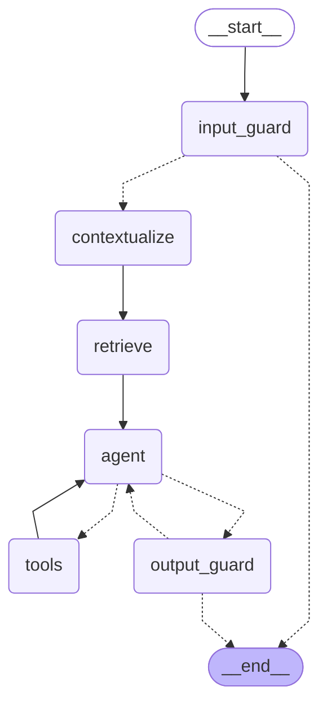

# Agent graph

Generated by `scripts/export_agent_graph.py` from the compiled LangGraph.

- `input_guard` validates, masks PII and screens for prompt injection; blocked inputs end here with a refusal.
- `retrieve` runs hybrid retrieval (vector + graph, re-ranked) first.
- `agent` calls the reasoning model with the tools bound; the final allowed step is made without tools.
- `tools` runs each requested tool and returns a `ToolMessage`, then control goes back to `agent`.
- `output_guard` checks leaks, citations and groundedness; a failed answer goes back to `agent` once.

