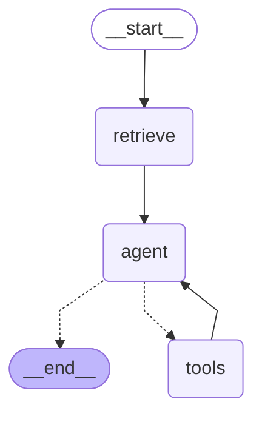

# Agent graph

Generated by `scripts/export_agent_graph.py` from the compiled LangGraph.

- `retrieve` runs hybrid retrieval (vector + graph, re-ranked) first.
- `agent` calls the reasoning model with the tools bound; the final allowed step is made without tools.
- `tools` runs each requested tool and returns a `ToolMessage`, then control goes back to `agent`.

