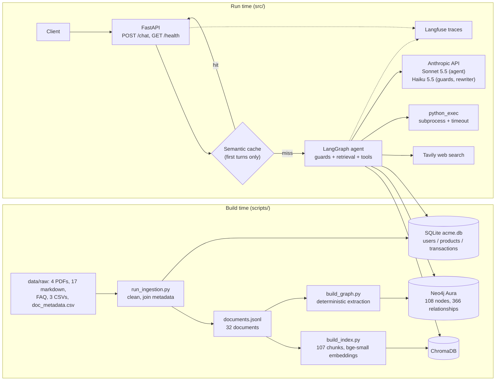
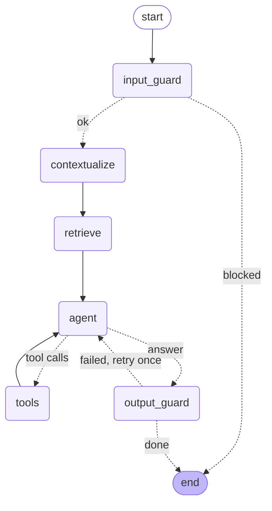

# Architecture

An enterprise knowledge assistant over a fictional company's (ACME Corp) IT-operations documents. It answers employee
questions with **hybrid retrieval** (vector search + a knowledge graph), a **LangGraph agent** with tools (SQL, web search,
Python), **layered guardrails**, a **FastAPI** backend with sessions and a semantic cache, **Langfuse** tracing, and automated
evaluation (Promptfoo, RAGAS, a safety scorecard). This document describes how the pieces fit and why; numbers come from the
reports in `eval/results/` and `eval/safety/`.

## System overview

Local models: `BAAI/bge-small-en-v1.5` (embeddings) and `cross-encoder/ms-marco-MiniLM-L-6-v2` (re-ranker). Everything the agent
knows comes from the retrieved context or a tool result; the system prompt tells it to say so when the context has no answer.

## Data and ingestion

The dataset is course-provided (not generated): 22 documents (4 policy PDFs POL-001..004, 5 incident reports INC-201..205, 7 SOPs,
5 system manuals), a FAQ (11 Q&A pairs, split into one document per pair, so 32 documents in all), three CSVs (46 users, 7 products,
200 transactions) and `doc_metadata.csv`, which links every document to the systems and SOPs it references.

Ingestion (`src/ingestion/`) loads each format into one `{doc_id, text, metadata}` shape, applies light cleaning only (whitespace and
PDF line-wrap artifacts, never rewriting content), and joins metadata by filename, normalising entity names (`Auth-Db` becomes
`Auth-DB`). The CSVs go to SQLite for the SQL tool and are deliberately **not** in the vector index: counts and sums need exact answers.

The data contains deliberate traps that shaped the design: incident reports that invert a dependency direction (INC-204 says
Auth-DB depends on Payment-Service; the manual says the reverse), `manual_auth_db` saying Auth-DB depends on itself, a FAQ that omits
DataWarehouse from Auth-DB's dependents and disagrees with SOP-05 on the escalation path, and near-identical templated incidents/SOPs.
The technical manuals are treated as the source of truth for dependencies; the conflicts are kept as test material, never "fixed".

## Retrieval: vector + graph, merged and re-ranked

**Chunking** (`src/ingestion/chunking.py`) is section-aware, not fixed-size: documents are short (about 200 to 2,050 characters, well under the embedding
model's 512-token limit), so the aim is meaningful boundaries, not fitting a window. Each chunk (107 in total, 200 to 630 characters) carries a context header such as
`[INC-204 | incident_report | Payment-Service, Auth-DB | Root Cause Analysis]`, because the templated documents are otherwise nearly
identical and the header holds the part that tells them apart. FAQ pairs stay whole.

**Knowledge graph** (`src/ingestion/graph_extract.py`, loaded into Neo4j by `scripts/build_graph.py`). Entities: Person, Team, System,
SOP, Policy, Incident, Document. Relationships: `DEPENDS_ON`, `OWNS`, `MANAGES`, `MEMBER_OF`, `RESOLVED_BY`, `RELATED_TO` (with a
`relation` property such as `system_owner` or `procedure_owner`) and `MENTIONS` (Document to entity, which maps graph results back to
vector chunks). Every relationship records its `source` document; `DEPENDS_ON` edges from manuals are `authoritative: true` and the
incident reports' conflicting edges are kept as `authoritative: false`.

*Extraction is deterministic, not LLM-based.* Every fact the graph needs sits in a templated header, a CSV column or a fixed sentence
pattern, so regexes extract it exactly. The rebuild is reproducible (the checks rely on that), costs nothing, and the graph cannot contain
an invented edge that looks authoritative. The trade-off is brittleness: if the templates change the regexes must change, and facts that
exist only in free prose are caught only when the wording is fixed. If a question needs such a fact, an LLM pass for that gap can be
added behind a flag.

**Hybrid retrieval** (`src/retrieval/hybrid.py`):

1. *Entity linking* matches the question against graph entity names (case-insensitive; hyphens, spaces and underscores interchangeable;
   teams only as "<team> team"). No fuzzy matching.
2. *Graph expansion* walks 1 to 2 hops over the dependency/ownership/resolution relationships and picks up to 8 documents: the document
   about each linked entity first, then documents about entities reached through `DEPENDS_ON`/`RESOLVED_BY` (so a SOP two hops away is not
   crowded out by documents that merely mention a hub like Auth-DB), then mention-based ranking.
3. *Candidates* are 20 vector hits plus all chunks of the graph documents, de-duplicated.
4. A *cross-encoder* re-ranks them; the top 8 are kept, at most 2 per document.
5. *Graph facts*: up to 20 short lines (`Priya Sharma RELATED_TO[procedure_owner] SOP-17 (source: SOP-17)`) go to the model alongside the
   chunks, ordered so that authoritative dependencies, then ownership facts about entities on a dependency/resolution path, come first.

**A cross-encoder scores a (question, passage) pair together, a bi-encoder (bge) scores them separately.** The cross-encoder is more
accurate but cannot be precomputed, so it only re-orders a short candidate list. It ranks by semantic similarity to the question, so
passages holding *answer-bearing structured fields* (`Procedure Owner:` in a SOP header) lose to prose passages: for "who owns those
SOPs?" the SOP overview chunks scored -6.7 to -3.3 and incident chunks +2 to +3.6, filling six of eight slots. That is why graph *facts*
exist: **the graph carries the relationships, the chunks carry the explanation.** Measured on 6 questions (26 expected sources): vector
top-5 found 12, vector top-8 15, vector + re-ranker 18, hybrid 19. In RAGAS (18 questions) context recall is 0.69 for vector-only, 0.80 for
the hybrid's chunks and 0.91 with the facts; on multi-hop questions 0.47, 0.53, 0.81.

Known retrieval gaps: the PII-breach question (Q4) never retrieves SOP-22 or POL-003 (nothing links "exfiltrated PII" to a procedure),
INC-205's header chunk (which names the incident lead) is sometimes missed, and the 20-fact cap is tight for hub entities like Auth-DB.

## The agent (LangGraph, built by hand)

(Exported from the compiled graph by `scripts/export_agent_graph.py`; see `docs/agent_graph.md`.)

State (`src/agent/state.py`) holds the message history, the retrieved chunks and graph facts for the current turn, a step counter, the
guard results and a retry counter. The retrieved context is kept out of `messages` and rebuilt into the system prompt on every agent call,
so saved session history never carries stale context.

**A tool call:** the agent node calls Sonnet 5.5 with the tools bound; if the reply has `tool_calls`, a conditional edge routes to the
`tools` node, which runs each call and returns a `ToolMessage` with the matching `tool_call_id`; control returns to the agent, which
either calls another tool or answers. A max-steps guard (6) makes the last call without tools, so the loop must end.

Tools (`src/agent/tools.py`): `sql_query` (read-only SQLite: the file is opened read-only and a SQLite authorizer allows only SELECT,
reads and functions; 50-row cap, 5 s limit, PII masked in the output), `web_search` (Tavily, 3 results, marked untrusted, never for
questions about ACME itself because it would return unrelated companies), `python_exec` (subprocess with a timeout, temp directory
and an empty environment; **not a sandbox**). The conversation is capped to the last 4 turns, and follow-ups are rewritten into
standalone questions by Haiku before retrieval ("What does it depend on?" becomes "What does Payment-Service depend on?").

## Guardrails (`src/guardrails/`)

| Where | Guard | On failure |
|---|---|---|
| Input | Validation (empty, over 2,000 chars) | Refusal, no retrieval or tools |
| Input | PII masking (emails, phones) before anything else sees the text | Not a failure: `[EMAIL]`, `[PHONE]` |
| Input | Prompt-injection patterns (deterministic), then a Haiku classifier for what they miss | Refusal, no retrieval or tools |
| Tool | `sql_query` masks PII in its output | Data minimisation |
| Output | Secret / system-prompt leak filter (key patterns, configured secret values, a canary token, 15-word verbatim runs) | **Always blocked** |
| Output | Citation validator (every `[chunk_id]`, `[graph:x]`, tool tag must exist this turn) | One retry with specific feedback, then a visible warning |
| Output | Groundedness judge (Haiku, per-claim verdicts) | Same retry-then-warning path |
| Output | PII masking backstop | Not a failure |

Every guard records `{guard, passed, action, reason}` in the state, returned in the API response and attached to the Langfuse trace.

**The two model-based guards fail open.** If the Haiku call errors, the guard records `skipped` and the turn continues. The deterministic
layers never depend on an API and always run (patterns before the classifier; leak filter and citation validator around the judge), and
each side has another layer behind it. Failing closed would turn every transient API error into a refusal for legitimate users, the
worse failure for an internal assistant; the cost is that during an outage the probabilistic layer is absent, which the recorded
`skipped` results make visible. The deterministic guards fail closed.

**The groundedness judge decides per claim** (claim, evidence, supported) and `grounded` is computed in code. The first version used one
`grounded` boolean plus a free-text list, and produced "unsupported claims" that said in their own text that they were supported,
failing correct answers. It also receives the assistant's own tool descriptions as a source for claims about itself, and, a known gap,
not the tool-call arguments (the SQL text or code), so it sometimes flags correct claims about how a number was computed.

## API, sessions and the semantic cache

`src/api/main.py` builds the retriever, guard models and compiled agent once (FastAPI lifespan) and serves `POST /chat` and
`GET /health` as plain `def` endpoints (run in a threadpool). Sessions are the LangGraph checkpointer's `thread_id` (`MemorySaver`: in
memory, lost on restart, never expired, single worker only; a per-session lock serialises concurrent requests for the same session).
Because saved state outlives a turn, `input_guard` resets per-turn fields, a blocked input is stored as a placeholder (the attack text never
enters later turns' history), and a request that fails mid-turn resets its session. Errors return a generic message; the server log
redacts secrets.

**Semantic cache** (`src/api/cache.py`): first-turn questions only; a hit needs embedding cosine at least 0.95 **and** the same
structural signature (ordered entities, numbers, negations, question and direction words). The second condition exists because
sentence embeddings barely see word order: "Does Auth-DB depend on Payment-Service?" and its reverse have cosine **0.996**, higher
than genuine paraphrases (0.92 to 0.97), so no threshold separates them and an embedding-only cache would replay the wrong answer.
In practice hits are limited to the same wording up to case, punctuation and hyphenation. Never cached: blocked or warned answers,
follow-ups, answers that used web search or where a guard failed open. Entries expire after an hour (TTL), the cache holds 500 entries,
and it can be disabled globally (`CACHE_ENABLED=false`) or per request (`use_cache: false`). A hit is shown in the response
(`cache_hit`, header `X-Cache`) and as a Langfuse tag; it also writes the exchange into the session so a follow-up still works.

## Observability (`src/observability/tracing.py`)

Every `/chat` request is one Langfuse trace: a root `chat` span, the LangGraph nodes as child spans, model calls as generations with
token usage, `session_id` = the chat session. Tags (`blocked`, `warned`, `follow-up`, `cache-hit`, `tool:<name>`, `error`) and metadata
(blocked, warning, rewritten query, tools used, flagged guards) are only known after the run, so they are attached then, to the root span
and to a final `result` event: when early child spans were stamped with `['chat']` the UI showed only that tag at trace level. The full
`guard_results` and `sources` sit in the root span's metadata. **PII never reaches Langfuse**: a `mask` hook masks emails, phones and
secrets in every input, output and metadata value before export (`scripts/check_api.py` fetches a trace back and fails if a raw value
is present). Errors are recorded on the root span (exception type only), and traces are flushed at shutdown. Each model call was
recorded twice (LangChain handler plus the Anthropic SDK's own span), doubling Langfuse's token and cost totals; the SDK-level spans are
now filtered out at export. Langfuse SDK 5 has no whole-trace read API, so checks read traces through the observations API and wait for
the observation count to stabilise (ingestion is out of order).

## Evaluation

| Evaluation | What | Headline (details in the linked file) |
|---|---|---|
| Promptfoo regression suite | 75 cases through `POST /chat`, deterministic assertions plus 2 `llm-rubric` cases | 72/75 in two full runs (after correcting two test definitions; 71/75 as first recorded) and 72/75 in a third run with the cache on; the same 3 cases fail every time (`eval/results/promptfoo_failure_analysis.md`) |
| RAGAS | 18 questions with references written from the documents | faithfulness 0.92, answer relevancy 0.92, context precision 0.72 to 0.74, context recall 0.91 (`eval/results/ragas_report.md`) |
| Safety scorecard | 49 prompts: 39 adversarial, 10 benign hard negatives | 39/39 handled, 1/10 benign blocked, 0 leaks; first-pass groundedness flag rate 5/19 (`eval/safety/safety_scorecard.md`) |
| Performance | latency cold vs cached, concurrency, cost | cold median 8.4 s, cache hit 0.026 s, 4 concurrent requests in 12.6 s, about $0.014 per cold question (`eval/results/performance_report.md`) |

## Limitations

- **`python_exec` is not a sandbox**: it limits accidents (timeout, empty environment, temp directory), not a hostile process.
- **No authentication, in-memory sessions and cache**: a `session_id` is effectively a bearer token; restart loses everything; run a single worker.
- **Heuristic injection defences**: regexes plus a model classifier, measured on a prompt set written alongside the guards (optimistic), with known false positives (2 of the 3 persistent Promptfoo failures).
- **Retrieval gaps** (above), a 20-fact cap, and no lexical (BM25) search.
- **Evaluation is small**: 18 RAGAS questions with self-written references and a judge from the same model family as the generator; two Promptfoo runs; one performance run of a few requests.
- **Not built**: model routing (see the performance report for why), an MCP server for a tool, a frontend, persistence.
